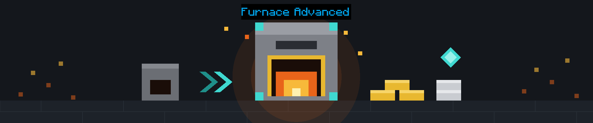
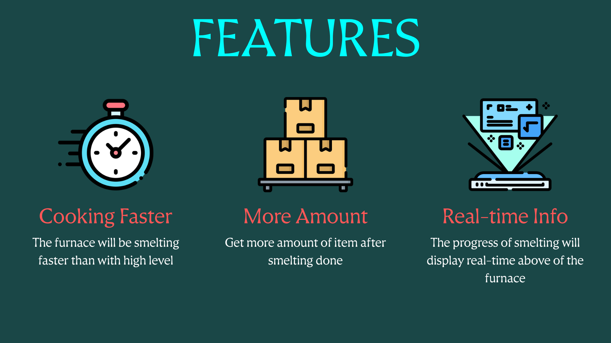
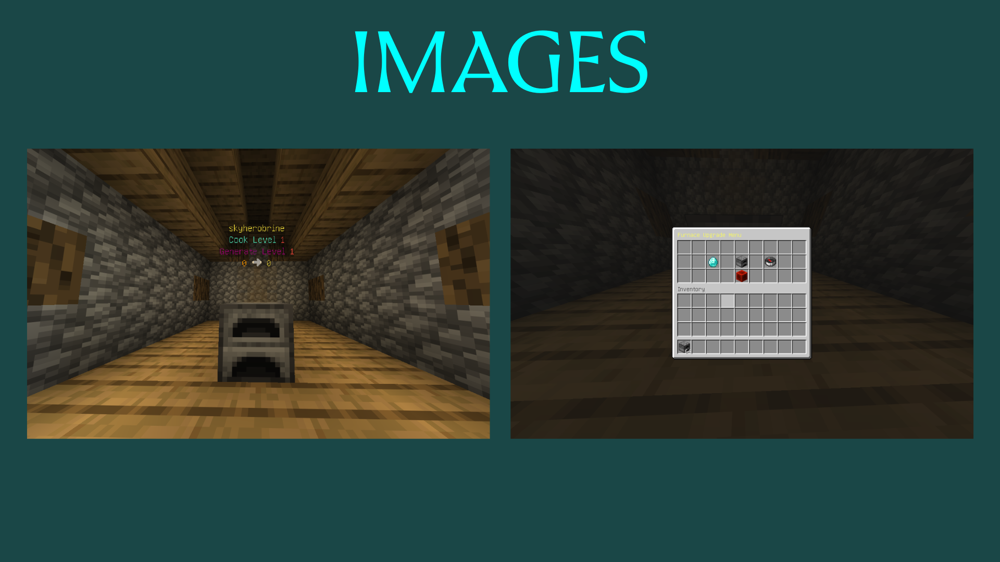
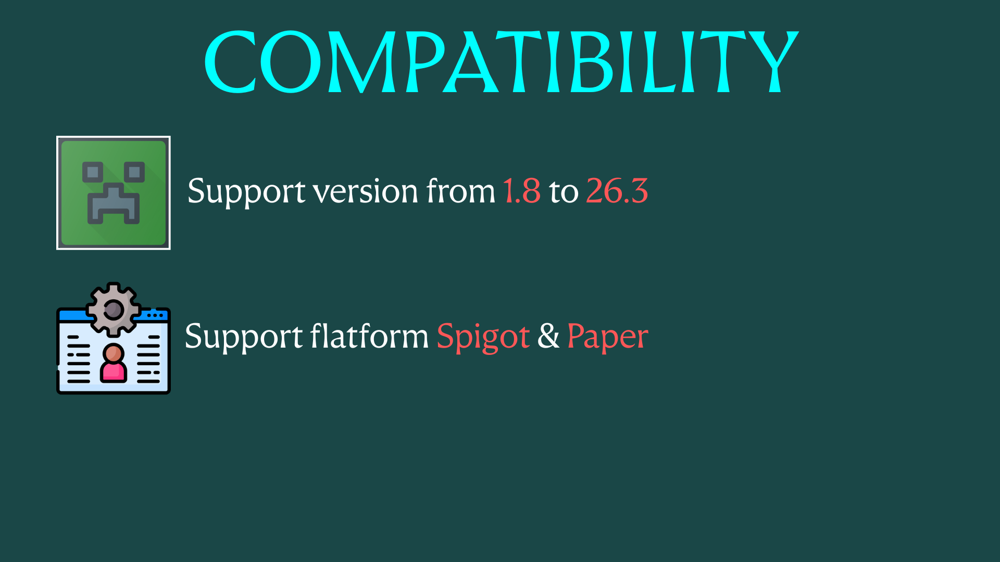
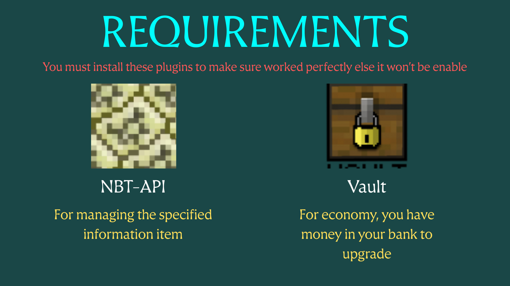
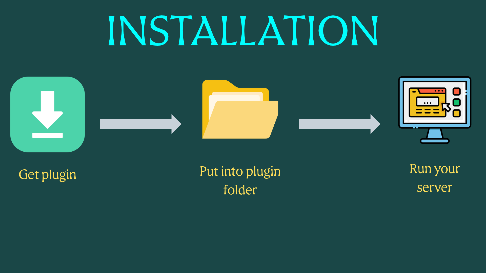
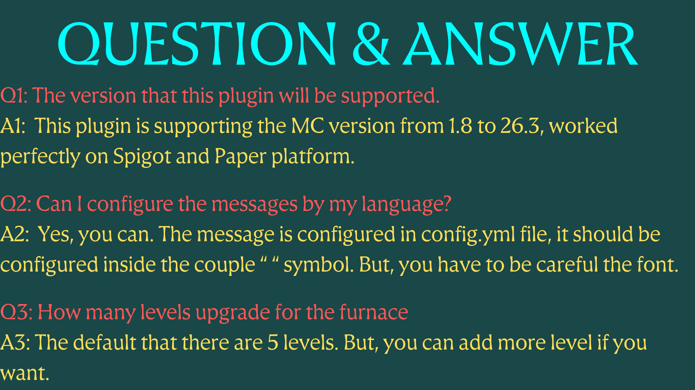
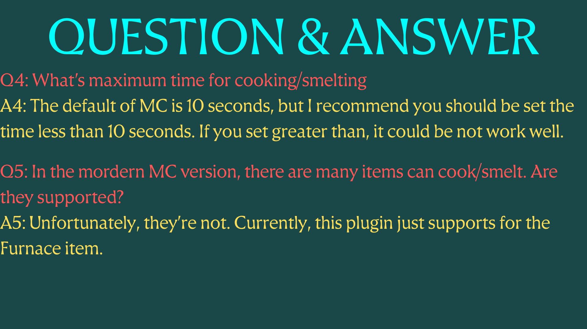
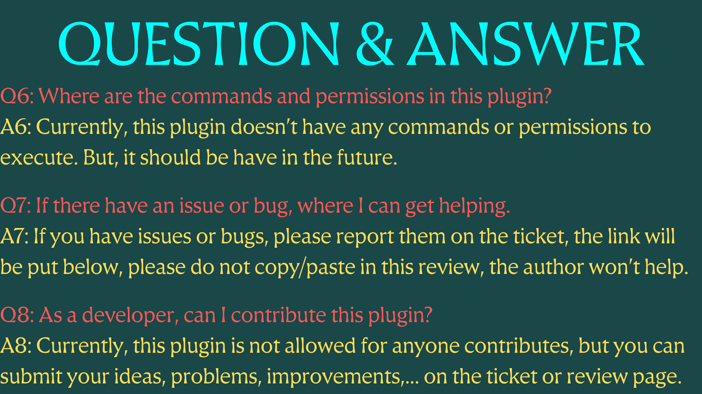

## Files
In this plugin will be had some additional file like:
1. furnaces.yml (for storing furnaces in your server)
2. furnaces.yml.temp (for storing temporarily furnaces)
3. furnaces.yml.bak (for backup furnaces)

> Please do not touch those file, these file for storing furnaces in your server

Plugin files:

1. config.yml (you can configure your messages language for yourself), if you lost the content of the file, you can copy this like a default. This file below always update latest and never outdated
```yaml
############################################
#                                          #
#             Furnace Advanced             #
#                                          #
############################################

# This plugin is created by @tdminhnhat.

# This file is used for configuring the plugin. Please make sure that don't put any empty or inconsistent value in this file else the plugin will be not working perfectly, and it maybe causes some errors in your server.
# The configuration for adjusting the message display during game always setup in couple " ". You also can adjust the color code for yourself if you want. The color code should be started the character '&' else they don't work.
# You can take a look all the color code in this website: https://minecraftitemids.com/color-codes

# Config the prefix plugin, every the message is notified the start message always contains the first prefix.
prefix-plugin: "&d&l[&b&lFurnaceAdvanced&d&l]"

# Upgrade the machine successfully.
upgrade-successfully: "&aUpgrade this machine successfully"

# When the player tried to upgrade, but this part has been already maximum level.
furnace-already-max-level: "&eThis upgrade has already been maximum level"

# If the player doesn't have enough money for upgrading, send them a message
not-enough-money-upgrade: "&4You don't have enough money to upgrade this machine"

#
#   Configuring the item lines when you get the furnace item into your slot inventory
#
item-inventory:
  display-name: "&d&l[&b&lFurnaceAdvanced&d&l]&f&l Furnace Technology"
  line: # Show the furnace information in your furnace item inventory. Do not remove the couple %...% or change format, but you can adjust the position for your customize in that line (not other line)
    # 1st line for showing author's furnace name
    1st-line: "&7Author: &e%player_name%"
    # 2nd line for showing the cook level of the furnace
    2nd-line: "&7Cook Level: &c%furnace_cook_level%"
    # 3rd line for showing the generate level of the furnace
    3rd-line: "&7Generate Level: &c%furnace_generate_level%"
  description:
    - "&fPlace the furnace and&4 SNEAKING + RIGHT-CLICK&f to open upgrade menu"

#
#   Configuring the message on hologram. Caution: there are 4 lines, do not remove or change the structure
#

holograms:
  # 1st line for showing author's furnace name
  1st-line: "&e%player_name%" # This %player_name% for showing the player's name has placed the furnace.
  # 2nd line for showing the cook level of the furnace
  2nd-line: "&bCook Level &c%furnace_cook_level%" # This %furnace_cook_level% for showing the furnace's cook level
  # 3rd line for showing the generate level of the furnace
  3rd-line: "&5Generate Level &c%furnace_generate_level%" # This %furnace_generate_level% for showing the furnace's generation level
  # 4th line for showing the progress status of smelting and resulting.
  4th-line: "&6%furnace_smelting_amount% &f➜ &e%furnace_resulting_amount%"

############################
#                          #
#       Config Menu#       #
#                          #
############################

#
#   Configuring the furnace upgrade menu
#

furnace-upgrade-menu:
  title: "&eFurnace Upgrade Menu"       # Set a name to the furnace upgrade menu.
  current-level: "&8(You)"
  generate-amount-item:                 # Configure the name of the item
    name: "&3Upgrade Generate Amount"
    description:
      - "&fIncreasing a number of item when smelting done"
      - "&fIt's random a chance"
    level-info:
      generate-exactly: "&eLevel &c%furnace_generate_level%&e:&a Exactly &c%furnace_generate_amount% &aamounts"
      generate-range: "&eLevel &c%furnace_generate_level%&e:&a Range &c%furnace_generate_amount_min% &ato &c%furnace_generate_amount_max% &aamounts"
    cost-info:
      info: "&7Cost: &4&l%furnace_generate_cost%&7. To upgrade the level &c&l%furnace_generate_next_level%"
      already-max: "&aYou have already upgraded this type to max level"
  open-furnace-inventory:
    name: "&eOpen Furnace Inventory"
    description:
      - "&fPut your ingredients and get the result"
      - "&fClick here to open the furnace inventory"
  cook-time-item:
    name: "&bUpgrade Cooking Time"
    description:
      - "&fDecreasing the time cook the ingredient"
      - "&fMake the furnace cook faster than normal"
    level-info: "&eLevel &c%furnace_cook_level%&e: &c%furnace_cook_time%&e seconds"
    cost-info:
      info: "&7Cost: &4&l%furnace_cook_cost%&7. To upgrade the level &4&l%furnace_cook_next_level%"
      already-max: "&aYou have already upgraded this type to max level"
  close:
    name: "&4Close Menu"

####################################
#                                  #
#       Config Furnace Level       #
#                                  #
####################################

# Config the amount of the result for cooking ingredient. Here you example:
# generate-result-level:
#   1: --> this describes the level of the generate result. This row of this level "MUST BE A POSITIVE NUMBER"
#     cost: 100  --> this describes the cost of money for this upgrading. In the first level, you don't need to specify the cost.
#     min: 1  --> this describes the minimum amount of the result This value "MUST BE A POSITIVE NUMBER AND SMALLER THAN MAX"
#     max: 4  --> this describes the maximum amount of the result. If you set the value equal the min, it means the amount of the result will be generated exactly that value after cooking done. This value "MUST BE A POSITIVE NUMBER AND GREATER THAN MIN"
generate-level:
  1:
    min: 1
    max: 1
  2:
    cost: 200
    min: 1
    max: 2
  3:
    cost: 400
    min: 1
    max: 4
  4:
    cost: 1000
    min: 2
    max: 6
  5:
    cost: 2000
    min: 3
    max: 8

# Config the furnace level. Here your example:
# cook-level:
#   1: --> this describes the level the cooking time. This row of this level "MUST BE A POSITIVE NUMBER"
#     cost: 10 --> this describes the level of the furnace level. This row of this level "MUST BE A POSITIVE NUMBER"
#     cook-time: 10  --> this describes that the time which cooks the ingredient is 10 seconds. This value "MUST BE A POSITIVE NUMBER"
cook-level:
  1:
    cook-time: 10
  2:
    cost: 150
    cook-time: 9
  3:
    cost: 300
    cook-time: 7
  4:
    cost: 500
    cook-time: 5
  5:
    cost: 1000
    cook-time: 3
```

[](https://bstats.org/plugin/bukkit/FurnaceAdvanced/35122)

> For the issue of the plugin, please create a ticket in here: https://github.com/tdmnhat-spigot-plugins/furnace-advanced/issues

> Join my discord to get the latest update, and get community supporting: https://discord.gg/PPbUt2rz3m